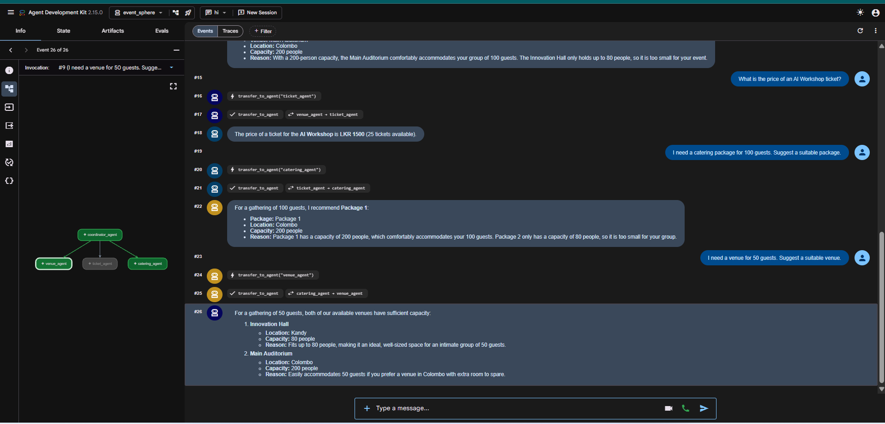

# Google ADK Event Management Multi-Agent System

A beginner-friendly multi-agent AI project built using Python and Google Agent Development Kit (ADK).

The system uses a Coordinator Agent to delegate tasks to three specialized agents.

## Agents

1. **Coordinator Agent** – Understands user requests and delegates tasks to the relevant agents.
2. **Venue Agent** – Recommends suitable venues based on guest capacity.
3. **Ticket Agent** – Provides event ticket prices and availability.
4. **Catering Agent** – Recommends suitable catering packages based on guest capacity.

## Technologies Used

- Python
- Google ADK
- Gemini 3.5 Flash

## Project Structure

```text
ADK/
├── .venv/
├── .gitignore
├── README.md
└── event_sphere/
    ├── .adk/
    ├── __init__.py
    ├── .env
    └── agent.py
```

## Project Setup

### 1. Create a project folder

```powershell
mkdir ADK
cd ADK
```

### 2. Create a virtual environment

```powershell
py -3.14 -m venv .venv
```

### 3. Activate the virtual environment

```powershell
.\.venv\Scripts\Activate.ps1
```

### 4. Install Google ADK

```bash
pip install google-adk
```

### 5. Create the ADK project

```bash
adk create event_sphere
```

During project creation:

- Select the Gemini model.
- Select Google AI as the model provider.
- Configure your Google API key.

### 6. Navigate to the project folder

```bash
cd event_sphere
```

### 7. Run the ADK web interface

```bash
adk web
```

Open the local URL displayed in the terminal:

```text
http://127.0.0.1:8000
```

## Demo

The following screenshot shows the EventSphere multi-agent system running in the Google ADK web interface.



## Example Requests

### Venue Agent

```text
I need a venue for 100 guests. Suggest a suitable venue.
```

### Ticket Agent

```text
What is the price of an AI Workshop ticket?
```

### Catering Agent

```text
I need a catering package for 100 guests. Suggest a suitable package.
```

## Configuration

Add your Google API key to the `.env` file inside the `event_sphere` folder.

**Important:** Never commit or publish your `.env` file or API key to GitHub.

## Learning Objectives

- Building multi-agent AI applications.
- Creating specialized agents.
- Delegating tasks between agents.
- Using a coordinator agent.
- Running AI agents with Google ADK.
